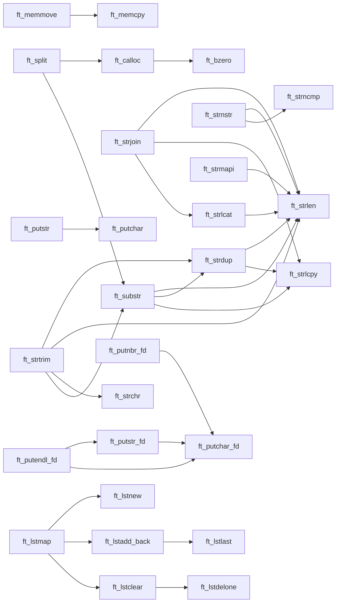

<h1 align="center">📚 libft</h1>

<p align="center">
  My first C library: <code>libc</code> functions rebuilt from scratch,
  extra utilities and linked lists.<br>
  A <b>42 Porto</b> project.
</p>

<p align="center">
  
  
  
</p>

---

## 🧭 Quick navigation

| I want to see... | Go to |
| --- | --- |
| How to build and use it | [⚙️ Build and use](#build) |
| Everything sorted by difficulty | [🎯 By difficulty](#difficulty) |
| Which function depends on which | [🧩 Dependency map](#dependencies) |
| Which functions use `malloc` | [💾 Memory allocation](#memory) |
| Full reference for every function | [📖 Reference by category](#reference) |
| How to test | [🧪 Testing](#testing) |
| How AI was used in this project | [🤖 AI usage](#ai-usage) |

> 💡 **Tip:** in the reference, every function is a collapsible section. Click the function's line to expand or collapse its details.

---

## 🚦 Difficulty legend

| Icon | Level | Meaning |
| :---: | --- | --- |
| 🟢 | Easy | Straightforward logic, few edge cases, no allocation |
| 🟡 | Medium | Pointers, casts or `malloc`, plus a few edge cases to handle |
| 🔴 | Hard | Several edge cases, memory handling or logic that needs care |

> The rating is an estimate based on each function's logic and edge cases, so it is subjective.

---

## 🗺️ Overview

| # | Category | Functions | Part |
| :---: | --- | :---: | --- |
| 1 | [🔤 Character checks](#ctype) | 5 | Part 1 |
| 2 | [🔡 Character conversion](#case) | 2 | Part 1 |
| 3 | [🔍 Strings: measure, compare and search](#str-query) | 5 | Part 1 |
| 4 | [📋 Strings: copy and concatenate](#str-copy) | 3 | Part 1 |
| 5 | [🧠 Memory](#mem) | 7 | Part 1 |
| 6 | [🔢 Numbers and text](#numbers) | 2 | Part 1 and 2 |
| 7 | [✂️ Creating and transforming strings](#str-new) | 6 | Part 2 |
| 8 | [🖨️ Writing to a file descriptor](#output) | 6 | Part 2 and extras |
| 9 | [🔗 Linked lists](#lists) | 9 | Part 3 |

**Total: 45 functions** (23 from `libc` in Part 1, 11 additional in Part 2, 9 linked-list functions in Part 3 and 2 extras outside the subject: `ft_putchar` and `ft_putstr`).

---

<a id="build"></a>
## ⚙️ Build and use

### Makefile rules

| Command | What it does |
| --- | --- |
| `make` | Builds everything and creates `libft.a` |
| `make clean` | Removes the object files (`.o`) |
| `make fclean` | Removes the `.o` files and `libft.a` |
| `make re` | `fclean` followed by `make` |
| `make norm` | Runs `norminette` on the `.c` and `.h` files |

Compilation flags: `-Wall -Wextra -Werror`.

### Using it in another project

```c
#include "libft.h"

int main(void)
{
	ft_putendl_fd("Hello, 42 Porto!", 1);
	return (0);
}
```

```bash
make
cc -Wall -Wextra -Werror main.c -L. -lft -o test
./test
```

---

<a id="difficulty"></a>
## 🎯 By difficulty

<details>
<summary><b>🟢 Easy</b> · 20 functions</summary>

| Category | Functions |
| --- | --- |
| Character checks | `ft_isalpha` `ft_isdigit` `ft_isalnum` `ft_isascii` `ft_isprint` |
| Character conversion | `ft_toupper` `ft_tolower` |
| Strings | `ft_strlen` `ft_strchr` |
| Memory | `ft_memset` `ft_bzero` |
| Output | `ft_putchar_fd` `ft_putstr_fd` `ft_putendl_fd` `ft_putchar` `ft_putstr` |
| Lists | `ft_lstnew` `ft_lstadd_front` `ft_lstsize` `ft_lstlast` |

</details>

<details>
<summary><b>🟡 Medium</b> · 17 functions</summary>

| Category | Functions |
| --- | --- |
| Strings | `ft_strrchr` `ft_strncmp` `ft_strlcpy` `ft_strdup` `ft_substr` `ft_strjoin` `ft_strmapi` `ft_striteri` |
| Memory | `ft_memchr` `ft_memcmp` `ft_memcpy` `ft_calloc` |
| Numbers | `ft_atoi` |
| Output | `ft_putnbr_fd` |
| Lists | `ft_lstadd_back` `ft_lstdelone` `ft_lstiter` |

</details>

<details>
<summary><b>🔴 Hard</b> · 8 functions</summary>

| Category | Functions | Why |
| --- | --- | --- |
| Memory | `ft_memmove` | Overlapping regions: it has to copy in different directions |
| Strings | `ft_strlcat` | Return value and truncation follow their own rules |
| Strings | `ft_strnstr` | Search limited by `len`, plus the empty substring case |
| Strings | `ft_strtrim` | Trimming both ends without going out of bounds |
| Strings | `ft_split` | Counting words, allocating a matrix and freeing everything on failure |
| Numbers | `ft_itoa` | `INT_MIN`, zero and negative numbers |
| Lists | `ft_lstclear` | Freeing nodes without losing the pointer to the next one |
| Lists | `ft_lstmap` | Building a new list and cleaning it all up if one node fails |

</details>

---

<a id="dependencies"></a>
## 🧩 Dependency map

An arrow `A --> B` means that `A` calls `B`. Useful for deciding in which order to implement and test.



Functions that **do not appear** in the map do not depend on any other function of the library.

---

<a id="memory"></a>
## 💾 Memory allocation

| Function | Allocates with `malloc`? | What you have to free |
| --- | :---: | --- |
| `ft_calloc` | ✅ | The returned block |
| `ft_strdup` | ✅ | The returned string |
| `ft_substr` | ✅ | The returned string |
| `ft_strjoin` | ✅ | The returned string |
| `ft_strtrim` | ✅ | The returned string |
| `ft_split` | ✅ | Each string, then the array |
| `ft_itoa` | ✅ | The returned string |
| `ft_strmapi` | ✅ | The returned string |
| `ft_lstnew` | ✅ | The node (via `ft_lstdelone` or `ft_lstclear`) |
| `ft_lstmap` | ✅ | The new list (via `ft_lstclear`) |

All the other functions allocate nothing.

---

<a id="reference"></a>
## 📖 Reference by category

<a id="ctype"></a>
### 🔤 Character checks

All of them take an `int` and return `1` (true) or `0` (false).

<details>
<summary><b>ft_isalpha</b> · 🟢 · <code>int ft_isalpha(int n)</code></summary>

Checks whether the character is a letter (`a-z` or `A-Z`).

```c
ft_isalpha('a');   // 1
ft_isalpha('7');   // 0
```

</details>

<details>
<summary><b>ft_isdigit</b> · 🟢 · <code>int ft_isdigit(int n)</code></summary>

Checks whether the character is a digit (`0-9`).

```c
ft_isdigit('7');   // 1
ft_isdigit('a');   // 0
```

</details>

<details>
<summary><b>ft_isalnum</b> · 🟢 · <code>int ft_isalnum(int n)</code></summary>

Checks whether the character is a letter or a digit.

```c
ft_isalnum('K');   // 1
ft_isalnum('_');   // 0
```

</details>

<details>
<summary><b>ft_isascii</b> · 🟢 · <code>int ft_isascii(int n)</code></summary>

Checks whether the value is in the ASCII table (`0` to `127`).

```c
ft_isascii(65);    // 1
ft_isascii(128);   // 0
ft_isascii(-1);    // 0
```

</details>

<details>
<summary><b>ft_isprint</b> · 🟢 · <code>int ft_isprint(int n)</code></summary>

Checks whether the character is printable (`32` to `126`, space included).

```c
ft_isprint(' ');    // 1
ft_isprint('\n');   // 0
```

</details>

<a id="case"></a>
### 🔡 Character conversion

<details>
<summary><b>ft_toupper</b> · 🟢 · <code>int ft_toupper(int c)</code></summary>

Converts a lowercase letter to uppercase. Any other value is returned unchanged.

```c
ft_toupper('a');   // 'A'
ft_toupper('7');   // '7'
```

</details>

<details>
<summary><b>ft_tolower</b> · 🟢 · <code>int ft_tolower(int c)</code></summary>

Converts an uppercase letter to lowercase. Any other value is returned unchanged.

```c
ft_tolower('Z');   // 'z'
ft_tolower('!');   // '!'
```

</details>

<a id="str-query"></a>
### 🔍 Strings: measure, compare and search

<details>
<summary><b>ft_strlen</b> · 🟢 · <code>size_t ft_strlen(const char *str)</code></summary>

Returns the number of characters in the string, not counting the `'\0'`.

```c
ft_strlen("42 Porto");   // 8
ft_strlen("");           // 0
```

</details>

<details>
<summary><b>ft_strchr</b> · 🟢 · <code>char *ft_strchr(const char *str, int c)</code></summary>

Returns a pointer to the **first** occurrence of `c`, or `NULL` if there is none. Searching for `'\0'` returns a pointer to the terminator.

```c
ft_strchr("42 Porto", 'o');    // "orto"
ft_strchr("42 Porto", 'z');    // NULL
```

</details>

<details>
<summary><b>ft_strrchr</b> · 🟡 · <code>char *ft_strrchr(const char *str, int c)</code></summary>

Same as `ft_strchr`, but returns the **last** occurrence. It compares `c` as an `unsigned char` and also finds the `'\0'`.

```c
ft_strrchr("42 Porto", 'o');   // "o"
ft_strrchr("42 Porto", 'z');   // NULL
```

</details>

<details>
<summary><b>ft_strncmp</b> · 🟡 · <code>int ft_strncmp(const char *s1, const char *s2, size_t n)</code></summary>

Compares up to `n` characters, stopping at the first different character or at the `'\0'`. The difference is computed as `unsigned char`.

- Returns `0` if they are equal in the first `n` characters.
- Returns a negative value if `s1 < s2` and a positive one if `s1 > s2`.

```c
ft_strncmp("abc", "abd", 2);   // 0
ft_strncmp("abc", "abd", 3);   // < 0
```

</details>

<details>
<summary><b>ft_strnstr</b> · 🔴 · <code>char *ft_strnstr(const char *big, const char *little, size_t len)</code></summary>

Looks for `little` inside `big`, checking at most the first `len` characters.

- If `little` is empty, returns `big`.
- If it is not found, returns `NULL`.
- **Depends on:** `ft_strlen`, `ft_strncmp`.

```c
ft_strnstr("Hello World", "World", 11);   // "World"
ft_strnstr("Hello World", "World", 8);    // NULL
ft_strnstr("Hello World", "", 3);         // "Hello World"
```

</details>

<a id="str-copy"></a>
### 📋 Strings: copy and concatenate

<details>
<summary><b>ft_strlcpy</b> · 🟡 · <code>size_t ft_strlcpy(char *dst, const char *src, size_t dstsize)</code></summary>

Copies `src` into `dst` without ever writing more than `dstsize` bytes, and always ends with `'\0'` (if `dstsize > 0`).

- Returns the **length of `src`**, which makes it possible to detect truncation (`return value >= dstsize`).
- With `dstsize == 0` it copies nothing.

```c
char dst[5];
ft_strlcpy(dst, "Hello World", 5);   // returns 11, dst = "Hell"
```

</details>

<details>
<summary><b>ft_strlcat</b> · 🔴 · <code>size_t ft_strlcat(char *dst, const char *src, size_t dstsize)</code></summary>

Appends `src` to the end of `dst`, without exceeding `dstsize` bytes in total, and ends with `'\0'`.

- Returns the length the string would have without truncation: `len(dst) + len(src)`.
- If `dstsize` is less than or equal to `len(dst)`, it writes nothing and returns `dstsize + len(src)`.
- **Depends on:** `ft_strlen`.

```c
char buf[10] = "42";
ft_strlcat(buf, " Porto", 10);   // returns 8, buf = "42 Porto"
```

</details>

<details>
<summary><b>ft_strdup</b> · 🟡 · <code>char *ft_strdup(const char *s1)</code> · 💾</summary>

Creates a **new copy** of the string in allocated memory. Returns `NULL` if `malloc` fails.

- **Depends on:** `ft_strlen`, `ft_strlcpy`.

```c
char *copy = ft_strdup("42 Porto");
// ...
free(copy);
```

</details>

<a id="mem"></a>
### 🧠 Memory

<details>
<summary><b>ft_memset</b> · 🟢 · <code>void *ft_memset(void *s, int c, size_t n)</code></summary>

Fills the first `n` bytes of `s` with the byte `c`. Returns `s`.

```c
char s[] = "Hello";
ft_memset(s, '.', 3);   // s = "...lo"
```

</details>

<details>
<summary><b>ft_bzero</b> · 🟢 · <code>void ft_bzero(void *s, size_t n)</code></summary>

Sets the first `n` bytes of `s` to zero. Returns nothing.

```c
char s[] = "Hello";
ft_bzero(s, 6);   // all bytes set to 0, including the final '\0'
```

</details>

<details>
<summary><b>ft_memcpy</b> · 🟡 · <code>void *ft_memcpy(void *dst, const void *src, size_t n)</code></summary>

Copies `n` bytes from `src` to `dst`. Returns `dst`.

- If `dst` and `src` are both `NULL`, it returns `dst` without doing anything.
- ⚠️ It does not handle **overlapping** regions: that is what `ft_memmove` is for.

```c
char dst[8];
ft_memcpy(dst, "42Porto", 8);   // dst = "42Porto"
```

</details>

<details>
<summary><b>ft_memmove</b> · 🔴 · <code>void *ft_memmove(void *dst, const void *src, size_t len)</code></summary>

Copies `len` bytes from `src` to `dst`, even if the regions overlap. Returns `dst`.

- If `dst > src`, it copies **from back to front** so data that has not been copied yet is not overwritten.
- Otherwise it copies normally with `ft_memcpy`.
- If `dst` and `src` are both `NULL`, or equal, or if `len == 0`, it returns `dst`.
- **Depends on:** `ft_memcpy`.

```c
char s[] = "abcdefghij";
ft_memmove(s + 3, s, 4);   // s = "abcabcdhij"
```

</details>

<details>
<summary><b>ft_memchr</b> · 🟡 · <code>void *ft_memchr(const void *s, int c, size_t n)</code></summary>

Looks for the byte `c` in the first `n` bytes of `s`. Returns a pointer to the first occurrence, or `NULL`. Unlike `ft_strchr`, it **does not stop at `'\0'`**.

```c
ft_memchr("Hello", 'l', 5);   // points to "llo"
ft_memchr("Hello", 'l', 2);   // NULL
```

</details>

<details>
<summary><b>ft_memcmp</b> · 🟡 · <code>int ft_memcmp(const void *s1, const void *s2, size_t n)</code></summary>

Compares `n` bytes (as `unsigned char`). Returns `0` if they are equal, or the difference of the first byte that differs. Unlike `ft_strncmp`, it **does not stop at `'\0'`**.

```c
ft_memcmp("Casa", "Casa", 4);   // 0
ft_memcmp("Casa", "Cama", 4);   // > 0
ft_memcmp("Casa", "Cama", 2);   // 0
```

</details>

<details>
<summary><b>ft_calloc</b> · 🟡 · <code>void *ft_calloc(size_t nmemb, size_t size)</code> · 💾</summary>

Allocates `nmemb * size` bytes **already set to zero**.

- If `nmemb` or `size` is `0`, it returns a minimal block (`malloc(1)`), which must also be freed.
- If `nmemb * size` overflows, it returns `NULL`.
- **Depends on:** `ft_bzero`.

```c
int *v = ft_calloc(4, sizeof(int));   // v[0..3] == 0
free(v);
```

</details>

<a id="numbers"></a>
### 🔢 Numbers and text

<details>
<summary><b>ft_atoi</b> · 🟡 · <code>int ft_atoi(const char *nptr)</code></summary>

Converts the beginning of a string into an `int`.

1. Skips leading whitespace (space, `\t`, `\n`, `\v`, `\f`, `\r`).
2. Accepts **one** sign (`+` or `-`).
3. Reads digits until the first character that is not one.

It does not handle overflow.

```c
ft_atoi("  -42abc");   // -42
ft_atoi("+7");         // 7
ft_atoi("--5");        // 0
```

</details>

<details>
<summary><b>ft_itoa</b> · 🔴 · <code>char *ft_itoa(int n)</code> · 💾</summary>

Converts an `int` into an allocated string. It uses a `long` internally, so `INT_MIN` works. It handles `0` and negative numbers.

```c
char *s = ft_itoa(-2147483648);   // "-2147483648"
free(s);
```

</details>

<a id="str-new"></a>
### ✂️ Creating and transforming strings

<details>
<summary><b>ft_substr</b> · 🟡 · <code>char *ft_substr(char const *s, unsigned int start, size_t len)</code> · 💾</summary>

Returns a new string with at most `len` characters, starting at index `start`.

- If `start` is greater than or equal to the length of `s`, it returns an empty (allocated) string.
- If `len` goes past the end, it cuts at the end of the string.
- **Depends on:** `ft_strlen`, `ft_strdup`, `ft_strlcpy`.

```c
ft_substr("Hello 42Porto", 6, 7);    // "42Porto"
ft_substr("Hello", 10, 3);           // ""
```

</details>

<details>
<summary><b>ft_strjoin</b> · 🟡 · <code>char *ft_strjoin(char const *s1, char const *s2)</code> · 💾</summary>

Joins `s1` and `s2` into a new string.

- **Depends on:** `ft_strlen`, `ft_strlcpy`, `ft_strlcat`.

```c
ft_strjoin("Hello ", "World");   // "Hello World"
```

</details>

<details>
<summary><b>ft_strtrim</b> · 🔴 · <code>char *ft_strtrim(char const *s1, char const *set)</code> · 💾</summary>

Removes from the start and the end of `s1` every character that belongs to `set`.

- If `s1` is `NULL`, it returns an empty string.
- If `set` is `NULL`, it returns a copy of `s1`.
- **Depends on:** `ft_strdup`, `ft_strlen`, `ft_strchr`, `ft_substr`.

```c
ft_strtrim("--..42Porto..-", "-.");   // "42Porto"
```

</details>

<details>
<summary><b>ft_split</b> · 🔴 · <code>char **ft_split(char const *s, char c)</code> · 💾</summary>

Splits `s` into words using `c` as the separator and returns a `NULL`-terminated array of strings.

- Consecutive separators are ignored (they do not produce empty strings).
- If `s` is `NULL`, it returns `NULL`.
- If an allocation fails, it frees everything it had already allocated and returns `NULL`.
- **Depends on:** `ft_calloc`, `ft_substr` (and three `static` helper functions).

```c
char **p = ft_split("a b  c", ' ');   // {"a", "b", "c", NULL}
// free each p[i], then p
```

</details>

<details>
<summary><b>ft_strmapi</b> · 🟡 · <code>char *ft_strmapi(char const *s, char (*f)(unsigned int, char))</code> · 💾</summary>

Applies `f(index, character)` to each character of `s` and returns a **new string** with the results. The original is not modified. Returns `NULL` if `s` or `f` is `NULL`.

- **Depends on:** `ft_strlen`.

```c
char upper_even(unsigned int i, char c)
{
	if (i % 2 == 0)
		return (ft_toupper(c));
	return (c);
}

ft_strmapi("hello", upper_even);   // "HeLlO"
```

</details>

<details>
<summary><b>ft_striteri</b> · 🟡 · <code>void ft_striteri(char *s, void (*f)(unsigned int, char *))</code></summary>

Applies `f(index, &character)` to each character of `s`, **modifying the string itself**. If `s` or `f` is `NULL`, it does nothing.

```c
void upper_even(unsigned int i, char *c)
{
	if (i % 2 == 0)
		*c = ft_toupper(*c);
}

char s[] = "hello";
ft_striteri(s, upper_even);   // s = "HeLlO"
```

</details>

<a id="output"></a>
### 🖨️ Writing to a file descriptor

The `fd` can be `1` (stdout), `2` (stderr) or the descriptor of an open file.

<details>
<summary><b>ft_putchar_fd</b> · 🟢 · <code>void ft_putchar_fd(char c, int fd)</code></summary>

Writes one character to the descriptor `fd`.

```c
ft_putchar_fd('A', 1);   // A
```

</details>

<details>
<summary><b>ft_putstr_fd</b> · 🟢 · <code>void ft_putstr_fd(char *s, int fd)</code></summary>

Writes the string `s` to the descriptor `fd`. If `s` is `NULL`, it does nothing.

- **Depends on:** `ft_putchar_fd`.

```c
ft_putstr_fd("42 Porto", 1);   // 42 Porto
```

</details>

<details>
<summary><b>ft_putendl_fd</b> · 🟢 · <code>void ft_putendl_fd(char *s, int fd)</code></summary>

Writes the string `s` followed by a newline.

- **Depends on:** `ft_putstr_fd`, `ft_putchar_fd`.

```c
ft_putendl_fd("Hello!", 1);   // Hello!\n
```

</details>

<details>
<summary><b>ft_putnbr_fd</b> · 🟡 · <code>void ft_putnbr_fd(int n, int fd)</code></summary>

Writes an integer to the descriptor `fd`, recursively, digit by digit. It uses a `long` to handle `INT_MIN`.

- **Depends on:** `ft_putchar_fd`.

```c
ft_putnbr_fd(-42, 1);          // -42
ft_putnbr_fd(-2147483648, 1);  // -2147483648
```

</details>

<details>
<summary><b>ft_putchar</b> · 🟢 · <code>void ft_putchar(char c)</code> · ➕ extra</summary>

Writes one character to `stdout`. Not part of the subject.

</details>

<details>
<summary><b>ft_putstr</b> · 🟢 · <code>void ft_putstr(char *str)</code> · ➕ extra</summary>

Writes a string to `stdout`. Not part of the subject.

- **Depends on:** `ft_putchar`.

</details>

<a id="lists"></a>
### 🔗 Linked lists (Part 3)

They all use this structure, declared in `libft.h`:

```c
typedef struct s_list
{
	void			*content;
	struct s_list	*next;
}	t_list;
```

```text
list ─► [content|next] ─► [content|next] ─► [content|next] ─► NULL
```

<details>
<summary><b>ft_lstnew</b> · 🟢 · <code>t_list *ft_lstnew(void *content)</code> · 💾</summary>

Creates a new node with the given `content` and `next = NULL`. Returns `NULL` if `malloc` fails.

```c
t_list *node = ft_lstnew(ft_strdup("First"));
```

</details>

<details>
<summary><b>ft_lstadd_front</b> · 🟢 · <code>void ft_lstadd_front(t_list **lst, t_list *new)</code></summary>

Inserts `new` at the **start** of the list. If `lst` or `new` is `NULL`, it does nothing.

```text
before: A ─► B ─► NULL
after:  new ─► A ─► B ─► NULL
```

</details>

<details>
<summary><b>ft_lstsize</b> · 🟢 · <code>unsigned int ft_lstsize(t_list *lst)</code></summary>

Counts the nodes in the list. A `NULL` list has size `0`.

```c
ft_lstsize(list);   // 3
```

</details>

<details>
<summary><b>ft_lstlast</b> · 🟢 · <code>t_list *ft_lstlast(t_list *lst)</code></summary>

Returns the **last** node of the list, or `NULL` if the list is empty.

</details>

<details>
<summary><b>ft_lstadd_back</b> · 🟡 · <code>void ft_lstadd_back(t_list **lst, t_list *new)</code></summary>

Inserts `new` at the **end** of the list. If the list is empty, `new` becomes the first node.

- **Depends on:** `ft_lstlast`.

```text
before: A ─► B ─► NULL
after:  A ─► B ─► new ─► NULL
```

</details>

<details>
<summary><b>ft_lstdelone</b> · 🟡 · <code>void ft_lstdelone(t_list *lst, void (*del)(void *))</code></summary>

Frees **one** node: calls `del(lst->content)` and then `free(lst)`. If `lst` or `del` is `NULL`, it does nothing.

⚠️ It does not update the `next` pointer of the previous node; that is the caller's responsibility.

</details>

<details>
<summary><b>ft_lstclear</b> · 🔴 · <code>void ft_lstclear(t_list **lst, void (*del)(void *))</code></summary>

Frees **every** node of the list and leaves `*lst` as `NULL`. It saves `next` before freeing each node. If `lst` or `del` is `NULL`, it does nothing.

- **Depends on:** `ft_lstdelone`.

```c
ft_lstclear(&list, free);   // list == NULL
```

</details>

<details>
<summary><b>ft_lstiter</b> · 🟡 · <code>void ft_lstiter(t_list *lst, void (*f)(void *))</code></summary>

Applies `f` to the `content` of each node, from first to last, **modifying the original list**.

```c
ft_lstiter(list, to_upper);   // every content goes through to_upper()
```

</details>

<details>
<summary><b>ft_lstmap</b> · 🔴 · <code>t_list *ft_lstmap(t_list *lst, void *(*f)(void *), void (*del)(void *))</code> · 💾</summary>

Creates a **new list** where each node holds `f(content)`. The original list is not modified.

- If a node cannot be created, it calls `del` on the new content, clears the whole new list and returns `NULL`.
- If `lst`, `f` or `del` is `NULL`, it returns `NULL`.
- **Depends on:** `ft_lstnew`, `ft_lstadd_back`, `ft_lstclear`.

```c
t_list *copy = ft_lstmap(list, dup_to_upper, free);
// ...
ft_lstclear(&list, free);
ft_lstclear(&copy, free);
```

</details>

---

<a id="testing"></a>
## 🧪 Testing

Write your tests in a **separate** `main.c`, outside the library files, and compile it against `libft.a`:

```bash
make
cc -Wall -Wextra -Werror main.c -L. -lft -o test
valgrind --leak-check=full ./test
```

Suggested order: test the functions that depend on no others first (see the [dependency map](#dependencies)), and only then the ones that use them.

For a more complete battery, there are community testers such as `libftTester` (Tripouille) and `libft-unit-test` (alelievr).

---

## ✅ Checklist before submitting

- [ ] `make` builds with no errors or warnings using `-Wall -Wextra -Werror`
- [ ] `make re` does not rebuild what is already built (no *relink*)
- [ ] `norminette` reports no errors
- [ ] No library file contains a `main()`
- [ ] No memory leaks (`valgrind`) in the functions that allocate
- [ ] No generated files in the repository (`*.o`, `libft.a`, `a.out`)
- [ ] Every prototype in `libft.h` matches the subject

---

<a id="ai-usage"></a>
## 🤖 AI usage

In line with 42's rules on transparency, this is how AI was used in this project:

- **Learning:** I used AI assistants to explain concepts (for example pointers, memory allocation, `unsigned char` casts, linked lists) and to help me understand how the functions are supposed to behave.
- **Documentation:** this README was written with the help of an AI assistant (Claude, by Anthropic), based on the project's source files.

---

## 👤 Author

**fercarva** · 42 Porto
